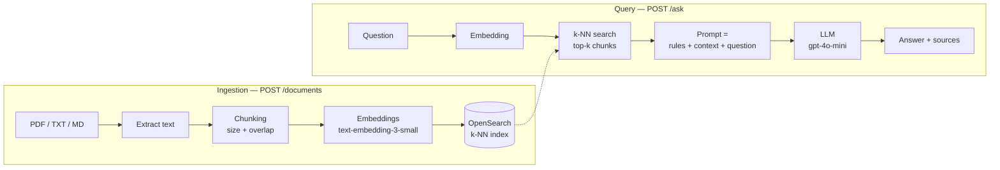

# Phase 1 — Basic RAG

A minimal but production-shaped RAG service: upload documents, ask questions, get answers grounded in those documents with their sources.



## What's inside

| File | Responsibility |
|---|---|
| `src/rag_from_scratch/chunking.py` | Splits text by paragraphs, then sentences, with overlap between chunks |
| `src/rag_from_scratch/ports.py` | `Protocol` interfaces for the embedder, the chat model and the vector store |
| `src/rag_from_scratch/rag.py` | `RagService`: ingestion and question answering, independent of any provider |
| `src/rag_from_scratch/openai_client.py` | OpenAI implementations (batched embeddings, `temperature=0` chat) |
| `src/rag_from_scratch/opensearch_store.py` | OpenSearch k-NN index (HNSW, cosine). The `text` field is also indexed for BM25 in a later phase |
| `src/rag_from_scratch/prompts.py` | Versioned prompts: changing a prompt is a reviewed code change |
| `src/rag_from_scratch/api.py` | FastAPI app: `POST /documents`, `POST /ask`, `GET /health` |
| `tests/` | Unit tests with fake implementations: no network, no cost, deterministic |

## Design decisions

- **Plain Python instead of a framework.** Every step of the pipeline is visible and testable.
- **Dependencies behind interfaces.** `RagService` only knows `Embedder`, `ChatModel` and `VectorStore`. Tests use in-memory fakes; switching to Azure OpenAI, Bedrock or a local model is a new class, not a rewrite.
- **No context, no LLM call.** If retrieval returns nothing, the service answers "not found" instead of letting the model guess.
- **Async end to end.** FastAPI, the OpenAI client and the OpenSearch client are all async.
- **Pydantic models as contracts** between layers and in the API.

## Run it

```bash
cp .env.example .env          # add your OPENAI_API_KEY
docker compose up -d          # OpenSearch on localhost:9200
pip install -e ".[dev]"
uvicorn rag_from_scratch.api:app --reload --app-dir src
```

```bash
curl -F "file=@manual.pdf" http://localhost:8000/documents
curl -X POST http://localhost:8000/ask -H "Content-Type: application/json" \
     -d '{"question": "What is the maintenance interval for the bogies?"}'
```

Tests: `pytest`

## Known limitations (addressed in the next phases)

- No way to measure answer quality yet → **Phase 2: evaluation**
- Pure vector search misses exact terms such as part numbers and codes → **Phase 3: hybrid retrieval**
- No linting, type checking or CI → **Phase 4**
