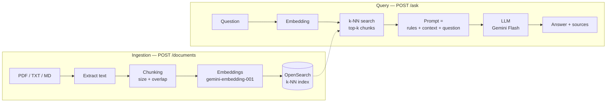

# Phase 1 — Basic RAG

A minimal but production-shaped RAG service: upload documents, ask questions, get answers grounded in those documents with their sources.



New to RAG? [This diagram](docs/how-rag-works-explained.png) follows one question through every step.

## Project structure

```
phase-01-basic-rag/
├── src/rag_from_scratch/
│   ├── main.py                  # FastAPI app, lifespan (wires the dependencies), routers
│   ├── core/
│   │   └── config.py            # settings from the environment / .env
│   ├── api/
│   │   ├── deps.py              # shared dependencies (get_rag)
│   │   └── routes/
│   │       ├── health.py        # GET  /health
│   │       ├── documents.py     # POST /documents
│   │       └── ask.py           # POST /ask
│   ├── schemas/                 # API request/response models
│   │   ├── documents.py
│   │   └── ask.py
│   ├── domain/
│   │   ├── models.py            # Chunk, RetrievedChunk
│   │   └── ports.py             # Protocols: Embedder, ChatModel, VectorStore
│   ├── services/
│   │   ├── rag.py               # RagService: ingestion and question answering
│   │   ├── chunking.py          # paragraph → sentence → character splitting, with overlap
│   │   ├── loaders.py           # text extraction (PDF, TXT, MD)
│   │   └── prompts.py           # versioned prompts
│   └── infrastructure/
│       ├── providers.py         # picks Gemini or OpenAI from LLM_PROVIDER
│       ├── gemini_client.py     # Gemini embeddings and chat
│       ├── openai_client.py     # OpenAI embeddings and chat
│       ├── retry.py             # backoff for rate limits (429) and server errors
│       └── opensearch_store.py  # OpenSearch k-NN index (HNSW, cosine)
├── tests/
│   ├── fakes.py                 # in-memory fakes for the Protocols
│   └── unit/
├── docs/                        # diagram and LinkedIn post
├── docker-compose.yml           # OpenSearch
└── pyproject.toml
```

The dependencies point inwards: `api` → `services` → `domain`. The `infrastructure` classes implement the `domain` Protocols and are only connected to the services in `main.py`.

## Design decisions

- **Plain Python instead of a framework.** Every step of the pipeline is visible and testable.
- **Dependencies behind interfaces.** `RagService` only knows `Embedder`, `ChatModel` and `VectorStore`. Tests use in-memory fakes; Gemini, OpenAI and a local Ollama are supported, chosen with `LLM_PROVIDER`; adding Bedrock or a local model is a new class, not a rewrite.
- **No context, no LLM call.** If retrieval returns nothing, the service answers "not found" instead of letting the model guess.
- **Separate query and document embeddings.** Gemini embeds documents with `RETRIEVAL_DOCUMENT` and questions with `RETRIEVAL_QUERY`, which improves retrieval. That's why the `Embedder` protocol has `embed_documents` and `embed_query`.
- **Async end to end.** FastAPI, the Gemini/OpenAI clients and the OpenSearch client are all async.
- **Pydantic models as contracts** between layers and in the API.

## Run it

Requires [uv](https://docs.astral.sh/uv/) (`curl -LsSf https://astral.sh/uv/install.sh | sh`). It installs the right Python version and the dependencies, with versions locked in `uv.lock`.

```bash
cp .env.example .env          # add your GEMINI_API_KEY (or set LLM_PROVIDER=openai)
docker compose up -d          # OpenSearch on localhost:9200
uv sync                       # creates .venv with Python 3.12 and installs everything
uv run uvicorn rag_from_scratch.main:app --reload --app-dir src
```

```bash
curl -F "file=@manual.pdf" http://localhost:8000/documents
curl -X POST http://localhost:8000/ask -H "Content-Type: application/json" \
     -d '{"question": "What is the maintenance interval for the bogies?"}'
```

Tests: `uv run pytest`

## Known limitations (addressed in the next phases)

- No way to measure answer quality yet → **Phase 2: evaluation**
- Pure vector search misses exact terms such as part numbers and codes → **Phase 3: hybrid retrieval**
- No linting, type checking or CI → **Phase 4**
