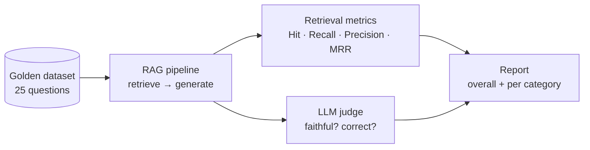

# Phase 2 — Evaluation

Phase 1 answers questions. This phase answers a harder question: **are the answers any good?**

Without measurement, every change (a new chunk size, a new prompt, a new model) is judged by trying two or three questions by hand. This phase adds a repeatable evaluation, so every change in the next phases is compared against a baseline with numbers.

New to the topic? [This diagram](docs/how-rag-evaluation-works.png) explains it without jargon.



## What's new compared with phase 1

| Change | Why |
|---|---|
| `evaluation/` package | dataset, metrics, judge, runner, report and a CLI |
| `data/corpus/` | 4 documents of a fictional train operator (invented data, safe to publish) |
| `data/eval/golden.jsonl` | 25 questions with a reference answer and the evidence needed |
| `RagService.retrieve` + `generate` | `ask` is split in two, so retrieval and generation are scored separately |
| `infrastructure/factory.py` | the API and the evaluation build exactly the same pipeline |
| `JUDGE_MODEL` setting | the judge can be a stronger model than the one that answers (default: `gemini-3.8-flash` judging `gemini-3.5-flash-lite`) |
| Smaller chunks (500/80) and top-3 | with 1000-character chunks the whole corpus was 8 chunks, and top-5 retrieved most of it: the retrieval metrics would always look perfect |

## The golden dataset

Each line has a question, a reference answer, a category and the **evidence**: the exact sentences from the corpus that are needed to answer.

```json
{"id": "q15", "question": "When must brake pads BRK-4471 be replaced?",
 "reference_answer": "When the pad thickness is below 7 mm.",
 "evidence": ["They must be replaced when the pad thickness is below 7 mm"],
 "category": "exact-code"}
```

Relevance is defined by evidence text instead of chunk ids, because chunk ids change whenever the chunking changes. A test checks that every evidence sentence really exists in the corpus.

| Category | Cases | What it tests |
|---|---|---|
| factual | 8 | direct questions using the document's words |
| paraphrase | 6 | same meaning, different words ("how fast can it go?") |
| exact-code | 5 | part numbers and fault codes (`BRK-4471`, `F-305`): hard for pure vector search |
| multi-hop | 3 | answers that need two facts from different places |
| unanswerable | 3 | the corpus has no answer: the system should say so, not invent one |

## The metrics

**Retrieval** (no LLM needed, cheap and deterministic). A chunk is relevant if it contains an evidence sentence.

| Metric | Question it answers |
|---|---|
| Hit@k | Was at least one relevant chunk in the top k? |
| Recall@k | What fraction of the needed evidence was found? (matters for multi-hop) |
| Precision@k | What fraction of the retrieved chunks were useful? |
| MRR | How high was the first relevant chunk? (1.0 = first place) |

**Generation** (LLM-as-a-judge, binary verdicts):

| Metric | Question it answers |
|---|---|
| Faithfulness | Is every claim supported by the retrieved context? Catches hallucinations, even lucky correct ones |
| Correctness | Does the answer agree with the reference? For unanswerable questions: did it decline instead of inventing? |

The judge is an LLM too, so it can be wrong. Its reason is saved for every case, and the report lists the incorrect answers so a human can review them.

## Run it

Requires [uv](https://docs.astral.sh/uv/) (`curl -LsSf https://astral.sh/uv/install.sh | sh`). It installs the right Python version and the dependencies, with versions locked in `uv.lock`.

```bash
cp .env.example .env          # add your GEMINI_API_KEY (or set LLM_PROVIDER=openai)
docker compose up -d
uv sync                       # creates .venv with Python 3.12 and installs everything

uv run python -m rag_from_scratch.evaluation              # full evaluation
uv run python -m rag_from_scratch.evaluation --no-judge   # retrieval only, almost free
uv run python -m rag_from_scratch.evaluation --k 5        # try another top-k
```

The CLI runs 2 questions at a time by default and retries rate-limit errors (429) with exponential backoff, so it also works on free API tiers. On a paid tier, `--concurrency 8` is much faster.

Each run uses a separate `rag-eval` index, recreated from scratch, and saves `eval-results/<timestamp>.json` (every case) and `.md` (summary table). The configuration (models, chunking, top-k, prompt versions) is stored in the report, so any result can be reproduced.

The API works as in phase 1: `uv run uvicorn rag_from_scratch.main:app --reload --app-dir src`. Tests: `uv run pytest`.

## Project structure (new parts)

```
src/rag_from_scratch/
├── evaluation/
│   ├── __main__.py     # CLI: reset index → ingest corpus → run → save report
│   ├── dataset.py      # EvalCase model and loader
│   ├── metrics.py      # hit, recall, precision, MRR (pure functions)
│   ├── judge.py        # LLM-as-a-judge: prompt, call, tolerant JSON parsing
│   ├── runner.py       # runs the cases concurrently (asyncio + semaphore)
│   └── report.py       # aggregates per category, renders Markdown
└── infrastructure/
    └── factory.py      # builds the real clients and the RagService
data/
├── corpus/             # fictional documents
└── eval/golden.jsonl   # the golden dataset
eval-results/           # reports of each run
```

## Known limitations (addressed in the next phases)

- The judge's JSON is parsed from free text, which can break → **Phase 5: structured outputs**
- Expect the `exact-code` category to be the weakest: embeddings are not good with codes like `BRK-4471` → **Phase 3: hybrid retrieval**
- The evaluation runs by hand → **Phase 4: CI with a quality gate**
