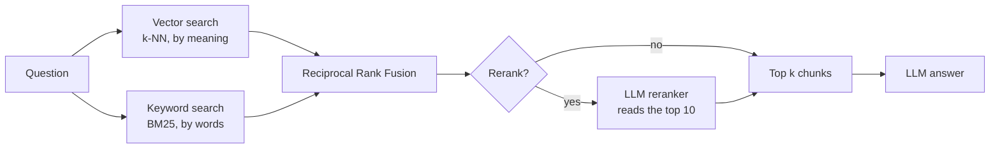

# Phase 3 — Hybrid retrieval

Phase 1 searched only by meaning (vectors). This phase adds search by words (BM25), merges the two with Reciprocal Rank Fusion, and adds an optional reranker. Then the phase 2 evaluation decides which strategy is better, with numbers.

New to the topic? [This diagram](docs/how-hybrid-search-works.png) explains it without jargon.



## Step 0: a harder exam

The phase 2 run showed Hit@3 and Recall@3 at 1.00 in every category: with 19 chunks about 4 clearly different topics, finding the right one was easy. A perfect score leaves no room to show that anything helps, so this phase first makes the exam harder:

| Change | Why it makes retrieval harder |
|---|---|
| `legacy-fleet-class-330.md` | a second, older fleet with the same kinds of facts (B-check, bogies, brake pads) but different numbers |
| `parts-catalogue.md` | look-alike part numbers: `BRK-4471`, `BRK-4417`, `BRK-4710`, `BRK-7441` |
| `fault-codes-reference.md` | look-alike fault codes: `F-127`, `F-172`, `F-217`, `F-271`, `F-712` |
| 15 new questions (40 in total) | code-only questions, questions about the older fleet, and 2 more unanswerable ones |
| old questions say "Aurora" | "How often is a B-check done?" now has two correct answers, so it became "…on Aurora trains?" |

The corpus now has 30 chunks, and a test checks that every evidence sentence appears exactly once in the corpus, so "found it" always means the right place.

**These numbers are not comparable with phase 2:** the questions and the corpus changed. All the comparisons in this phase are between strategies on this same, harder exam.

## The strategies

| Strategy | How it ranks | Good at | Weak at |
|---|---|---|---|
| `vector` | similarity of embeddings | paraphrases: "bike" ↔ "bicycle" | exact codes: to an embedding, `F-217` ≈ `F-271` |
| `keyword` | BM25 on the `text` field | exact codes and names | different words for the same idea |
| `hybrid` | both, merged with RRF | (hopefully) both | twice the searches, still fast |
| `hybrid+rerank` | hybrid, then an LLM reorders the top 10 | picking the right one among look-alikes | one more LLM call per question |

### Reciprocal Rank Fusion

Each chunk receives `1 / (60 + position)` from every list it appears in, and the points are added up:

```
by meaning: A, B, C        by words: B, D, A
B = 1/62 + 1/61 = 0.0325   A = 1/61 + 1/63 = 0.0323   D = 1/62   C = 1/63
merged: B, A, D, C
```

RRF uses only positions, never the original scores, because a BM25 score (like 12.7) and a cosine similarity (like 0.83) are on different scales and can't be added. The constant 60 comes from the original paper (Cormack, Clarke and Büttcher, 2009): it softens the gap between the first positions, so a chunk found by both searches can beat one that is first in only one.

### Reranking

The reranker reads the question and the 10 best merged chunks together and returns them in a new order. It uses the LLM (listwise reranking), so it works with any provider, including Ollama. Production systems usually use a dedicated cross-encoder model instead (faster and cheaper per call); the `Reranker` protocol makes that a one-class change.

## Run it

```bash
cp .env.example .env
docker compose up -d
uv sync

uv run python -m rag_from_scratch.evaluation --no-judge                 # vector vs keyword vs hybrid
uv run python -m rag_from_scratch.evaluation --no-judge \
       --modes hybrid,hybrid+rerank                                     # does the reranker help?
uv run python -m rag_from_scratch.evaluation --modes vector,hybrid      # with the judge
```

The corpus is ingested once, then every strategy answers the same 40 questions. The results go to `eval-results/<timestamp>/`: one report per strategy and a `comparison.md` with one row per strategy, including the MRR per category, because the interesting differences are expected in `exact-code` and `paraphrase`.

The API uses `RETRIEVAL_MODE` (default `hybrid`), and a request can choose another one:

```bash
curl -X POST http://localhost:8000/ask -H "Content-Type: application/json" \
     -d '{"question": "What is F-271?", "mode": "keyword"}'
```

## What's new compared with phase 2

```
src/rag_from_scratch/
├── domain/ports.py                 # SearchStore (vector_search + keyword_search), Reranker
├── services/
│   ├── retrieval.py                # Retriever: vector / keyword / hybrid, RRF
│   └── reranking.py                # LLMReranker with tolerant JSON parsing
├── infrastructure/opensearch_store.py   # BM25 match query on the same index
└── evaluation/
    ├── variants.py                 # "vector", "hybrid+rerank", ... parsed from --modes
    └── report.py                   # + comparison table across strategies
data/corpus/                        # + 3 documents with look-alike codes and a second fleet
data/eval/golden.jsonl              # 40 questions (was 25)
```

New settings: `RETRIEVAL_MODE`, `RETRIEVAL_CANDIDATES` (chunks per search before fusion, default 20), `RRF_K` (60), `RERANK`, `RERANK_MODEL`, `RERANK_CANDIDATES` (10).

## Known limitations (addressed in the next phases)

- The evaluation still runs by hand → **Phase 4: CI with a quality gate**
- The judge and the reranker parse JSON from free text → **Phase 5: structured outputs**
